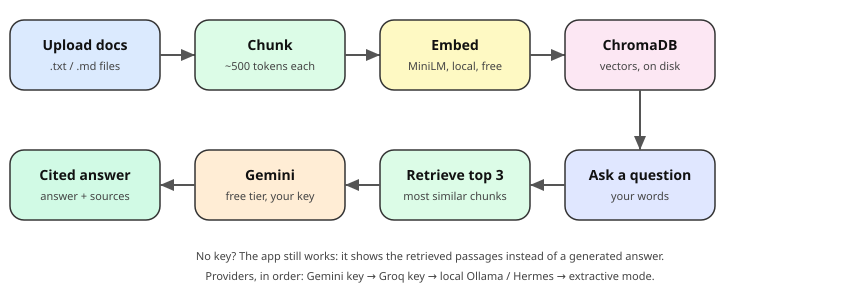

# RAG Quickstart

A working RAG product you can run on your own machine, free. Ask a question,
get an answer with the source chunks underneath. That citation part is the
whole point: an answer without a source is not usable in regulated work.



Stack: Python 3, FastAPI + Uvicorn, ChromaDB (local, persistent),
fastembed running the `sentence-transformers/all-MiniLM-L6-v2` model via ONNX (free, local,
real 384-dim vector embeddings, no key). Note: the original spec used
sentence-transformers, but its install pulls a 550MB+ CUDA torch wheel
that stalled on this VM, so the embedding backend was switched to
fastembed running the same model. Retrieval is still genuine vector
similarity search, not keyword search.

## LLM providers (priority order — first available wins)

1. **Groq** — `GROQ_API_KEY`, model `openai/gpt-oss-20b`. Free, no card.
2. **Google Gemini** — `GEMINI_API_KEY`, model `gemini-2.5-flash`
   (falls back to `gemini-2.0-flash` if 2.5 is not accepted).
3. **Ollama, local** — no key at all. Set `OLLAMA_MODEL` to a model name,
   or leave it unset and the app auto-detects: a Hermes model first if one
   is installed, otherwise any installed model. Ollama runs at
   http://localhost:11434.

With none of the three, the app runs in extractive mode: it returns the
top retrieved chunks with the most relevant passage highlighted, and says
clearly which option would enable generation. Nothing ever crashes for
lack of a key.

## How to run (2 commands)

```bash
cd ~/workspace/rag-quickstart
source .venv/bin/activate && uvicorn app:app --port 8000
```

Then open http://127.0.0.1:8000 in your browser. On first run the app
ingests the 3 seed documents in `seed_docs/` automatically.

## How to get a free Groq key (no card)

1. Go to https://groq.com and create a free account.
2. Open the API Keys page and create a key.
3. Run the server with it set:

```bash
GROQ_API_KEY=your_key_here uvicorn app:app --port 8000
```

## How to get a free Gemini key (AI Studio, no card)

1. Go to https://aistudio.google.com and sign in with your Google account.
2. Get an API key from the API Keys page.
3. Run the server with it set:

```bash
GEMINI_API_KEY=your_key_here uvicorn app:app --port 8000
```

## How to use Ollama (fully local, no key)

1. Install Ollama from https://ollama.com and pull a model, e.g.
   `ollama pull hermes3` (or whatever Hermes model you already have).
2. Make sure Ollama is running (`ollama list` shows your models).
3. Run the server normally — with no keys set, it auto-detects your
   Hermes model. To force a specific model:

```bash
OLLAMA_MODEL=hermes3 uvicorn app:app --port 8000
```

With any provider set, answers are generated from the retrieved chunks and
still cite their sources. Without one, nothing crashes — you get
extractive mode instead.

## How to test it (3 example questions)

Ask these in the UI or with curl:

```bash
curl -s -X POST http://127.0.0.1:8000/ask -H 'Content-Type: application/json' \
  -d '{"question": "What is the storm deductible in the sample policy?"}'
# Expected: 500 (standard deductible is 250; storm is 500), cited from
# 02-sample-policy-wording.md.

curl -s -X POST http://127.0.0.1:8000/ask -H 'Content-Type: application/json' \
  -d '{"question": "What does FNOL mean and what happens first in a claim?"}'
# Expected: First Notice of Loss — the policyholder's first report of a
# loss — followed by triage, cited from 01-claimsorted-product.md.

curl -s -X POST http://127.0.0.1:8000/ask -H 'Content-Type: application/json' \
  -d '{"question": "What is an eval in a RAG system?"}'
# Expected: a test for a RAG system (right chunk cited, refuses when the
# documents lack the answer, stays accurate as documents grow), cited
# from 03-how-rag-works.md.
```

## Troubleshooting

**`No matching distribution found for onnxruntime` on install:** your Python
is too new (3.14+ has no onnxruntime builds yet). Use Python 3.12:

```bash
brew install python@3.12
deactivate; rm -rf .venv
python3.12 -m venv .venv && source .venv/bin/activate
pip install -r requirements.txt
```

## Endpoints

- `GET /` — the single-page UI (ask + upload).
- `GET /health` — status, chunk count, embedding model, LLM mode.
- `POST /ask` — `{"question": "..."}` returns `{"answer", "sources": [{doc, chunk, text}], "mode"}`.
- `POST /ingest` — multipart file upload (`.txt`/`.md`) or a `text` form field.

## Files

- `app.py` — the whole backend + retrieval + generation logic.
- `index.html` — the UI, served by FastAPI, no build step.
- `seed_docs/` — 3 seed documents (ClaimSorted summary, fictional policy
  wording, RAG explainer). All invented/fictional where marked; no real
  company data.
- `chroma_db/` — the persistent ChromaDB store (created on first run).
